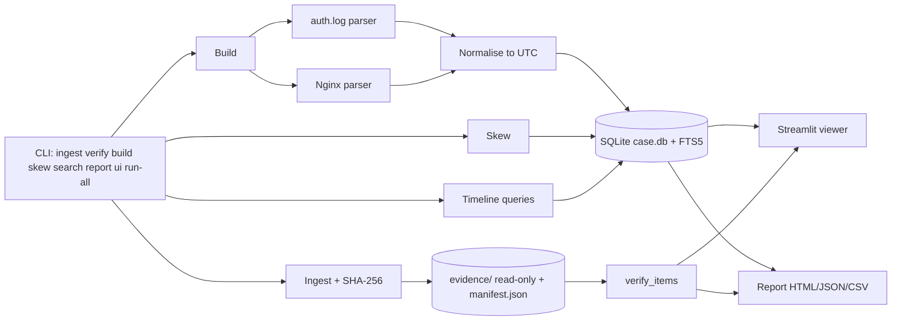
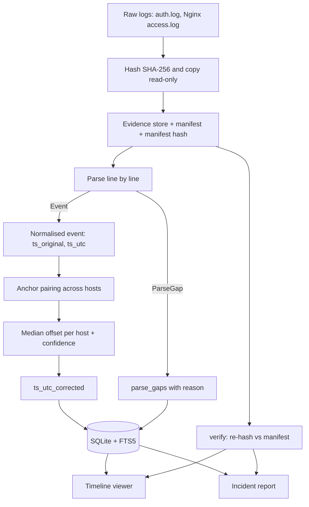

# PS-013 Final Plan: Finish Everything Today (Sat 10 Oct 2026)

Team repo: `Manasvi-hub/A3-PS013-TC067` (will be transferred to `aiori-hackathon`). Submission deadline: Wed 14 Oct. Finishing today leaves Sun to Wed as pure buffer.

**People:** Gayatri = A (evidence and parsing core). Manasvi = B (scenarios, timeline, viewer, report, evaluation, deck).

---

## 1. Verified starting point (`main` = `e0b0893`)

| Done and verified | Evidence |
|---|---|
| Evidence pipeline: ingest, SHA-256 manifest, `verify`, parsers (auth.log, Nginx), normalize, skew, build, `pipeline.run_case`, `run-all` | 26 tests pass, 0 skipped, ruff clean, 8 CLI commands |
| 3 scenarios with ground truth; all 18 steps match within 1.5 s; gaps 4 / 5 / 0; S3 skew −421.5 s (10 anchors) | ground-truth tests pass |
| Timeline queries, FTS, report (HTML/JSON/CSV, 8 sections, hashes, verification status OK), viewer with 5 tabs | 0 "UNKNOWN" in reports |
| Repo hygiene: no egg-info tracked, CODEOWNERS fixed, guides in `docs/` | clean `git status` |

| Still to do | Why it matters |
|---|---|
| Viewer "Verify integrity" button is a stub (prints "ingest.py missing") | Required demo moment (tamper then detect) |
| `mock_s3_db.py` in repo root | Clutter, risk of demoing fake data |
| `evaluation/triage_results.csv` is placeholder data | **PS requires a triage-time comparison vs manual baseline; fake numbers must not be submitted** |
| `parsing_gap_analysis.md`, `triage_summary.md` not generated | PS deliverable: parsing-gap and triage-time analysis |
| No deck PDF, demo script, or pseudocode in `docs/` | PS deliverables 2 and 3 |
| Ownership transfer to `aiori-hackathon` not confirmed | Required for the participation certificate |

---

## 2. Schedule for today (time-boxed, run in parallel)

Times are relative (T+). Start now.

| Block | T+ | Gayatri | Manasvi |
|---|---|---|---|
| **1** | 0:00 to 1:00 | Prompt G1: pseudocode, final-check script, README demo section. Then start deck text (section 5) in Overleaf | Prompt M1: viewer verify button, move mock, triage timer, reset CSV |
| **2** | 1:00 to 1:15 | Both: merge both PRs, pull `main`, run `python scripts/final_check.py` | same |
| **3** | 1:15 to 2:15 | **Triage experiment** (section 4), 3 sessions each | **Triage experiment**, 3 sessions each |
| **4** | 2:15 to 2:45 | Commit CSV, run summarize and gap_report, push | Review generated analysis |
| **5** | 2:45 to 4:15 | Deck text slides (problem, background, literature, bibliography, timeline) | Deck: architecture + DFD diagrams (section 6), solution, optimization table with real numbers |
| **6** | 4:15 to 4:45 | Export PDF, commit `A3-PS013-TC067.pdf` | Demo rehearsal x2 with `docs/demo_script.md` |
| **7** | 4:45 to 5:15 | Final check, ownership transfer, tag `v1.0-submission` | Same, verify access |

Rules: branch from `main`, small PRs, **merge commit (not squash)** to preserve authorship, rebase before every push, never edit the other person's files without asking.

---

## 3. Antigravity prompts

### Prompt M1 (Manasvi, branch `b/final-polish` from `main`)

````text
Repo: Python package `forensic` (src layout), branch `b/final-polish` from main. I am Manasvi. Edit ONLY: viewer/app.py, scenarios/fixtures/ (move one file), evaluation/, tests/test_viewer_imports.py (extend only). Do not edit src/forensic/*.py other than nothing at all.

1. viewer/app.py, Evidence tab: the "Verify integrity" button currently prints "Verification not available (ingest.py missing)". Replace it: `from forensic.ingest import verify_items` (import at the top of the file; the module exists). On click call verify_items(case_dir) where case_dir = Path(db_path).parent, show a dataframe with columns file, status, expected, actual, colour OK green and anything else red (st.success / st.error counts: "N OK, M problems"). Persist the result in st.session_state so it survives reruns. No try/except that hides errors; show st.exception on failure.
2. `git mv mock_s3_db.py scenarios/fixtures/mock_s3_db.py` and fix any path or import inside it so `python scenarios/fixtures/mock_s3_db.py` still works from the repo root. Add a docstring at the top: "DEV ONLY: builds a fake case for UI development. Never use for demos or reports."
3. evaluation/triage_results.csv: delete every data row (it is placeholder data). Keep ONLY the header `scenario,tester,condition,question_id,seconds,correct,notes`.
4. New file evaluation/triage_timer.py (stdlib only). Usage: `python evaluation/triage_timer.py --scenario s1_ssh_bruteforce --tester Gayatri --condition manual|tool`. Behaviour: read scenarios/<scenario>/ground_truth.json -> "triage_questions" (list of {"q","answer"}). For each question: print "Q<i>: <q>", wait for Enter to START the stopwatch (time.perf_counter), wait for Enter to STOP, then ask "Your answer:", compare with the expected answer after normalising (strip, lowercase, remove trailing Z, treat "2026-10-03T02:19:51Z" and "02:19:51" as equal when the time part matches), print CORRECT/INCORRECT (show the expected answer only after the person typed theirs), ask optional notes, and append a row to evaluation/triage_results.csv with seconds rounded to 1 decimal. Print a final per-session summary (total seconds, correct count). Refuse to run if the same (scenario, tester, condition) already exists in the CSV unless --force is given.
5. evaluation/summarize.py: read the CSV and write evaluation/triage_summary.md: table per scenario and condition (median seconds, total seconds, accuracy), overall median per condition, speed-up = manual median / tool median, and a Limitations section (n is small; testers know the tool; scenario author had prior knowledge; synthetic data). If the CSV has no data rows, write "No data yet" and exit 0 (do not fabricate numbers).
6. evaluation/gap_report.py: run `forensic run-all`'s output cases in cases/ (call forensic.timeline.gap_summary on each cases/*/case.db) and write evaluation/parsing_gap_analysis.md: a table per scenario/file (total lines, parsed, gaps, blank lines, parsed %, reasons), then a discussion section with the gap categories (no_regex_match, bad_timestamp, truncated, empty_line, encoding_error: what causes each, tool limitation vs malformed input) and a "What the tool does not parse" list (RFC 5424 syslog, Apache error log, JSON logs, multi-line stack traces, non-UTF-8 logs, DST-ambiguous local times).
7. tests/test_viewer_imports.py: also assert that forensic.ingest has `verify_items`.

Acceptance: `python -m pytest -q` 0 failures and 0 skipped; `ruff check src tests evaluation viewer scenarios`; `forensic run-all` then `streamlit run viewer/app.py -- --case cases/s3_clock_skew` Evidence tab -> click Verify -> all OK; append a byte to a stored evidence file (chmod u+w first) -> click again -> shows TAMPERED for that file. Run `python evaluation/gap_report.py` and confirm parsing_gap_analysis.md is written. Commit (feat(viewer): working integrity check; chore: move mock; feat(eval): triage timer and honest summary), push, do not merge.
````

### Prompt G1 (Gayatri, branch `a/final-docs` from `main`)

````text
Repo: Python package `forensic`, branch `a/final-docs` from main. I am Gayatri. Create ONLY: docs/pseudocode.md, scripts/final_check.py, and edit README.md. Do not touch src/, viewer/, scenarios/, evaluation/ or tests/.

1. docs/pseudocode.md: a title "Core algorithm (pseudocode)" and this snippet in a code block, followed by a short paragraph per stage (collect, parse, normalise, skew, timeline, report):
for each source file:
    h = SHA256(file)                      # hash before anything else
    copy file to evidence/ (read-only); record (name, h, size, collector, utc_now) in DB + manifest.json
    manifest_hash = SHA256(manifest.json) # manifest is tamper-evident too
for each stored evidence file, line by line:
    result = parser(line, ctx)            # ctx = host, source_type, declared_tz, year_hint
    if result is Event:  keep line_no, byte_offset, raw_line
    else:                store ParseGap(line_no, reason, raw_line)   # nothing is silently dropped
    ts_utc = to_utc(ts_original, declared_tz, year_hint)   # syslog: add year, apply tz, handle Dec->Jan rollover
anchors = pairs of events with same (src_ip, event_type, detail) on different hosts, nearest in time, one-to-one
offset[host] = median(ref_ts - host_ts over anchors)       # needs >= 3 anchors
confidence = high if stdev < 2s and n >= 5 else medium if stdev < 10s else low
for each event: ts_corrected = ts_utc + offset[host]       # ts_original and raw_line never modified
timeline = events ordered by ts_corrected; search via SQLite FTS5
report = summary + manifest(hashes, verify status) + skew table + gaps + limitations
2. scripts/final_check.py (stdlib + subprocess, cross-platform, run from repo root, exit code 1 if any check fails, print PASS/FAIL per check): (a) `python -m pytest -q` passes with 0 failed and 0 skipped (parse the summary line); (b) `ruff check src tests`; (c) `forensic --help` lists ingest, verify, build, skew, search, report, ui, run-all; (d) `forensic run-all` exits 0 and prints 4, 5, 0 gaps for s1, s2, s3 and an anchor_median skew row for db01; (e) tamper test: make one evidence file in cases/s3_clock_skew writable, append a byte, `forensic verify` must exit 1 and print TAMPERED, then re-run `forensic run-all` to restore; (f) no "UNKNOWN" and no "<<<<<<<" in reports/*.html or tracked files; (g) git hygiene: no tracked egg-info, cases/, reports/, __pycache__; (h) required files exist: README.md, docs/pseudocode.md, docs/demo_script.md, evaluation/triage_summary.md, evaluation/parsing_gap_analysis.md, and a PDF named A3-PS013-TC067.pdf in the repo root or docs/ (report missing ones as FAIL).
3. README.md: keep the existing content; add a "Demo walkthrough" section (the 6 commands: run-all, verify, tamper + verify, search "UNION", report, ui), a "Scenarios" table (S1 SSH brute force, S2 web attack, S3 clock skew with expected gaps 4/5/0 and skew -420 s), a "Results" section with placeholders `<!-- RESULTS -->` for later, and a "Deliverables" checklist linking docs/pseudocode.md, docs/demo_script.md, the PDF, evaluation/*.md.
Acceptance: `python scripts/final_check.py` runs (missing deliverables are allowed to FAIL for now but must be listed), ruff clean. Commit (docs: pseudocode, README demo; chore: final check script), push, do not merge.
````

---

## 4. Triage experiment (Block 3, about 60 minutes, **real measurements only**)

Purpose (PS requirement): compare triage time against a **manual baseline**.

**Questions:** the 3 per scenario in `ground_truth.json` (the timer tool reads them). 

**Who does what** (each person does 3 timed sessions, scenarios alternate so nobody does the same scenario twice):

| Scenario | Manual (grep/sort/less only) | Tool (`forensic search` or viewer) |
|---|---|---|
| S1 | Gayatri | Manasvi |
| S2 | Manasvi | Gayatri |
| S3 | Gayatri | Manasvi |

If a third person (classmate) is available, give them the S2 manual session instead of Manasvi, because Manasvi wrote the scenarios and already knows the answers.

**How:**
1. `forensic run-all` first, so cases exist. Manual testers work on the raw logs in `scenarios/<s>/` only.
2. Run `python evaluation/triage_timer.py --scenario <s> --tester <name> --condition manual|tool`.
3. No peeking at ground truth; wrong answers are recorded, not retried.
4. When all 6 sessions are done: `python evaluation/summarize.py && python evaluation/gap_report.py`, review `evaluation/triage_summary.md` and `evaluation/parsing_gap_analysis.md`, commit.

**Report honestly:** n = 6 sessions, small sample, testers know the tool, author bias on S2/S3. Do not round or tweak numbers. If the tool is slower on some question, report that.

---

## 5. Deck text (Beamer template slide by slide; paste into Overleaf)

Title ID: **A3-PS013-TC067**. Title: *Incident Timeline and Evidence Collection for Small Teams*. Authors: Gayatri Sanjay Karanjkar, Manasvi (add full name), AIORI Hackathon 3, 10 October 2026.

**Abstract / Problem**
- After a breach, small IT teams rebuild attack timelines by hand from scattered text logs.
- Logs differ in format; clocks are unaligned (different time zones and drift; syslog lines have no year or time zone).
- Careless copying or editing of logs weakens the evidence.
- Goal: a lightweight tool that preserves evidence with hashes, normalises time to UTC, corrects clock skew, and produces a searchable timeline and report.

**Background**
- Forensics in incident response follows collect, examine, analyze, report (NIST SP 800-86 [1]).
- Small teams lack SIEMs or forensic suites; they rely on grep and spreadsheets.
- Integrity relies on cryptographic hashing at collection (SHA-256, FIPS 180-4 [5]) and keeping originals untouched.
- Out of scope: live endpoint takeover, malware removal, forensic certification.

**Literature and RFC review** (keep to these)
- NIST SP 800-86: integrating forensic techniques into incident response [1].
- RFC 3164 / RFC 5424: syslog formats; RFC 3164 timestamps carry no year or zone [2][3].
- RFC 3339: internet timestamp format used for our normalised UTC timestamps [4].
- Plaso/log2timeline and Timesketch: powerful timeline tools, heavier to deploy than our target setting [6][7].
- Nginx combined log format: contains its own UTC offset [8].

**Proposed solution** (pipeline): Collect and hash → read-only evidence store + manifest → parse (auth.log, Nginx) into SQLite → normalise to UTC → anchor-based skew correction → searchable timeline (FTS5) → HTML/JSON/CSV report. Every event links back to file, line number and byte offset.

**Optimization** (table; fill numbers from `triage_summary.md`, never invent):

| | Manual (grep/Excel) | This tool |
|---|---|---|
| Median triage time per question | `<from CSV>` | `<from CSV>` |
| Evidence integrity | none | SHA-256 manifest + `verify` |
| Original vs normalised | mixed | originals read-only, normalised copy separate |
| Clock skew | by hand | anchor-median correction with confidence note |
| Unparsed lines | silently missed | recorded with reason and reported |

**Architecture (UML) and Data-flow diagram:** use the Mermaid sources in section 6.

**Results** (from our run): 3 scenarios; parse coverage per file; gaps 4 / 5 / 0; S3 skew −421.5 s from 10 anchors (high confidence) against a true −420 s; all 18 ground-truth steps matched within 1.5 s; triage numbers from the CSV; 26 automated tests passing.

**Limitations:** syslog year and time zone are operator-declared; skew assumes the paired events occurred within about 5 s; DST fold ambiguity; only two log formats; synthetic data; not forensically certified.

**Deployment timeline:** 7 to 14 Oct: repo and contract (7), scenarios and ingest (8), parsers and timeline (9), skew and viewer (10), integration and evaluation (10 to 11), deck and demo (10 to 13), submission (14).

**Bibliography (real references):**
1. K. Kent, S. Chevalier, T. Grance, H. Dang, *Guide to Integrating Forensic Techniques into Incident Response*, NIST SP 800-86, 2006.
2. C. Lonvick, *The BSD Syslog Protocol*, RFC 3164, 2001.
3. R. Gerhards, *The Syslog Protocol*, RFC 5424, 2009.
4. G. Klyne, C. Newman, *Date and Time on the Internet: Timestamps*, RFC 3339, 2002.
5. NIST, *Secure Hash Standard (SHS)*, FIPS 180-4, 2015.
6. Plaso (log2timeline) project documentation, github.com/log2timeline/plaso.
7. Timesketch project documentation, github.com/google/timesketch.
8. Nginx documentation, `ngx_http_log_module` (log_format).

Please double-check each reference before submitting.

---

## 6. Diagram sources (paste into mermaid.live, export PNG for the deck)

**Architecture**


**Data flow**


---

## 7. Demo script (5 minutes, `docs/demo_script.md`)

| Time | Action | Say |
|---|---|---|
| 0:00 | Slide: problem | Small teams rebuild timelines by hand; logs are messy, clocks drift, evidence integrity is fragile |
| 0:20 | `forensic run-all` | One command: ingest, hash, parse, skew-correct three synthetic incidents |
| 0:50 | Show `cases/s3_clock_skew/manifest.json` | Every file has a SHA-256 and the manifest is hashed too |
| 1:10 | Append a byte to a stored file, `forensic verify --case cases/s3_clock_skew` | Tampering is detected: `TAMPERED`, exit code 1 |
| 1:40 | `forensic run-all` again (restores) then viewer on S3 | Parsing coverage and gaps are shown, nothing silently dropped |
| 2:10 | Viewer, S3, untick "Use skew-corrected time", then tick it | db01 login moves from 09:19:45 to about 09:12:44; the causal order (webshell, then pivot, then sudo) is restored |
| 3:00 | Click the event, show raw line, evidence file, line number, SHA-256 | Every event traces back to the exact source line |
| 3:20 | `forensic search --case cases/s2_web_attack "UNION"` | Searchable timeline |
| 3:40 | Open `reports/s3_clock_skew.html` | Exportable report: hashes, verification status, skew with confidence, gaps, limitations |
| 4:10 | Triage table | Real measured times against grep baseline, with honest limitations |
| 4:40 | Pseudocode slide (docs/pseudocode.md) | Core algorithm in 20 lines |

Fallback: keep prebuilt `cases/` and `reports/` and a screen recording of the run.

---

## 8. Final submission checklist (Block 7)

Run `python scripts/final_check.py` on a fresh clone, then:

- [ ] Both PRs (`b/final-polish`, `a/final-docs`) merged with **merge commits**
- [ ] `python scripts/final_check.py` shows all PASS
- [ ] `evaluation/triage_results.csv` has 18 real rows (6 sessions x 3 questions), `triage_summary.md` and `parsing_gap_analysis.md` committed
- [ ] `A3-PS013-TC067.pdf` in the repo root, following `Proposed-structure-hackathon.pdf` (title ID `A3-PS013-TC067`, real bibliography, no placeholders or "Image" boxes, no lorem ipsum)
- [ ] `docs/pseudocode.md` and `docs/demo_script.md` committed; demo rehearsed twice
- [ ] Repo is **private**, named after the team (`A3-PS013-TC067`)
- [ ] `aiori-hackathon` has accepted the collaborator invite (Settings, Collaborators). Both teammates have accepted
- [ ] **Transfer ownership to `aiori-hackathon`** last: Manasvi (the owner) goes to Settings, General, Danger Zone, Transfer ownership, new owner `aiori-hackathon`. Gayatri confirms she can still push afterwards
- [ ] Delete merged branches (`a/core-setup`, `a/final-docs`, `b/*`)
- [ ] `git tag v1.0-submission && git push origin v1.0-submission`
- [ ] Mentor demo scheduled; prototype demo with pseudocode snippet ready

## 9. If time runs short, cut in this order
Viewer charts, then CSV report polish, then extra README text. **Never cut:** hash and verify, original vs normalised separation, skew, parsing gaps, real triage numbers, deck PDF, pseudocode, ownership transfer.
